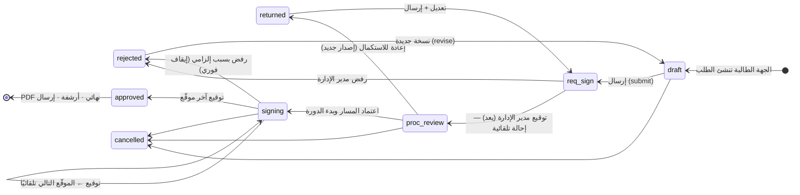
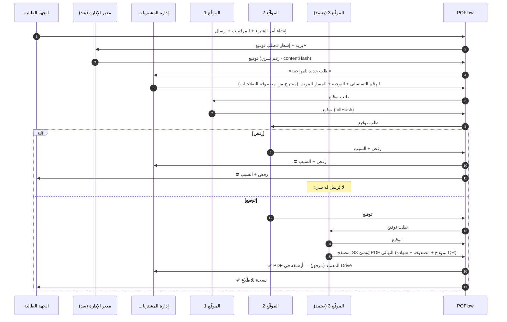

# POFlow v1.3 — مخطط سير العمل · Workflow

## قواعد المحرك
- **التسلسل:** خطوة واحدة فقط `current`؛ التوقيع على غيرها مرفوض في الخادم.
- **الانتقال التلقائي:** بعد كل توقيع تصبح أول خطوة `pending` من نوع `sign` هي `current` ويُرسل لها الطلب (ولمفوَّضيها).
- **«يعلم»:** خطوات `inform` لا توقّع؛ تُبلَّغ مع النسخة النهائية.
- **الرفض:** يوقف الدورة؛ الخطوات اللاحقة تبقى `pending` ولا يُرسل لها شيء. الاستئناف = `revise` ثم دورة جديدة كاملة.
- **التذكير والتصعيد:** كل ساعة — تذكير بعد `REMIND_HOURS`، وتصعيد لـ `ESCALATE_EMAIL` والمشتريات بعد `ESCALATE_DAYS` أو تجاوز الموعد المستهدف (مرة يوميًا).
- **التفويض:** `Delegations` النشطة في التاريخ تجعل المفوَّض «صاحب خطوة» بالنيابة؛ يُسجّل `onBehalfOf` في التوقيع والمستند والشهادة.
- **الفصل بين المشتريات ومحرك الاعتماد:** المشتريات تحدد السلسلة فقط؛ التنفيذ آلي بالكامل.
